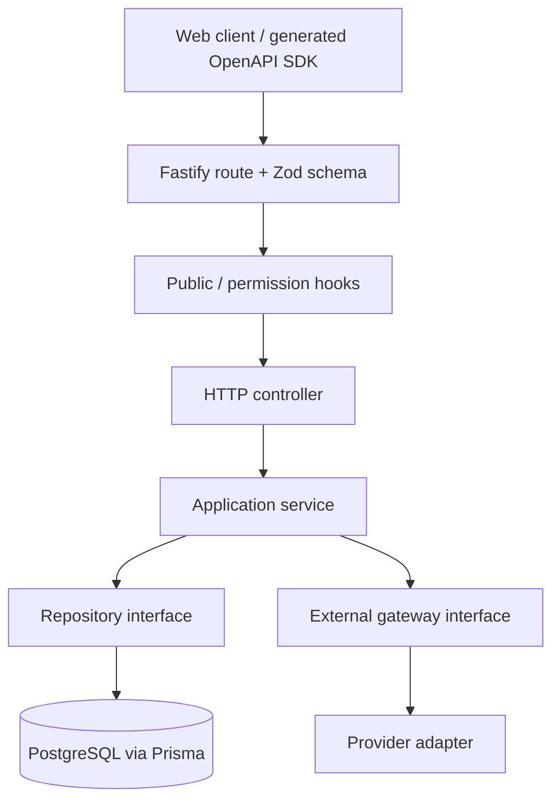

# Community Storefront — API

A TypeScript/Fastify API for the [Community Storefront web application](https://github.com/mkwitko/udv-shop), covering stores, products, orders, donations, and supporting business workflows.

> **Portfolio note:** Descriptions below are grounded in the checked-in implementation and architecture docs. They are not claims of current production traffic, security certification, or independently benchmarked performance.

## Engineering highlights

- **Use-case-oriented architecture.** HTTP controllers, Zod contracts, application services, and repositories are separated by feature, limiting coupling between business logic and frameworks.
- **Explicit authorization.** Routes declare either public access or an explicit set of permissions; the architecture documents a deny-by-default guard.
- **Contract-first consumption.** Zod request/response schemas generate an OpenAPI document that is used to generate the frontend's typed client.
- **Testability.** Services accept injected repositories/gateways; E2E tests use Fastify's `app.inject` with a test database and gateway mocks.
- **Backend workflows.** The codebase contains routes and tests for authentication, stores, products, purchases, donations, reporting, gateways, webhooks, and payouts.
- **Infrastructure.** Docker, Prisma migrations, observability hooks, and separate deployment configuration.

### Stack

| Layer | Technology |
| --- | --- |
| Server | Node.js, TypeScript, Fastify 5 |
| Validation / contract | Zod, fastify-type-provider-zod, OpenAPI / Swagger |
| Persistence | PostgreSQL, Prisma |
| Auth and security | JWT, HTTP-only refresh cookies, explicit permissions, Helmet, CORS, rate limits |
| Payments / external services | Stripe, Pix-related integrations and gateway adapters |
| Testing | Vitest, Fastify injection tests, PostgreSQL test setup |
| Ops | Docker, structured logging, deployment configuration |

## Architecture



For rationale and constraints, see [architecture](docs/ARCHITECTURE.md), [decisions](docs/DECISIONS.md), and [integrations](docs/INTEGRATIONS.md).

## Local development

**Prerequisites:** pnpm, Node.js, Docker with Docker Compose, PostgreSQL configured through the provided compose file.

```bash
cp .env.example .env
pnpm install
pnpm keys:generate
pnpm db:generate
pnpm db:migrate
pnpm db:seed
pnpm dev
```

The `pnpm dev` script starts the development database compose service and the API watch process. Configure required values from `.env.example` before running. Do not commit any `.env` file containing tokens, signing keys, or provider secrets.

**API docs (local):** http://localhost:3333/docs

**Development fixtures:** `pnpm db:seed` creates sample data and development-only users; see the seed implementation for local fixture details. Treat generated/test credentials strictly as development data; never reuse them for deployed systems.

## Contract with the frontend

```bash
pnpm openapi:export
```

This exports [`docs/openapi.json`](docs/openapi.json) from declared route schemas. The [web client](https://github.com/mkwitko/udv-shop) generates its typed bindings from this specification.

## Tests and quality

```bash
pnpm typecheck
pnpm lint
pnpm test
pnpm build
```

Tests require a separate test database as configured by the repository. The [`test/e2e`](test/e2e) folder contains scenario coverage for authorization, products, orders, payments, webhooks, donations and other flows. These commands were identified from package scripts; **the portfolio review did not execute the test suite**.

## Security and scope

Repository code contains safeguards for auth, validation, payment flows, and cross-origin access. Security still depends on environment configuration, private secrets, operational controls, and independent testing; this README is not an audit or certification. Do not share live credentials, user records or real transaction data in issues, examples or screenshots.

**Further documentation:** [Deploy](docs/DEPLOY.md) · [Architecture](docs/ARCHITECTURE.md) · [Decisions](docs/DECISIONS.md)
