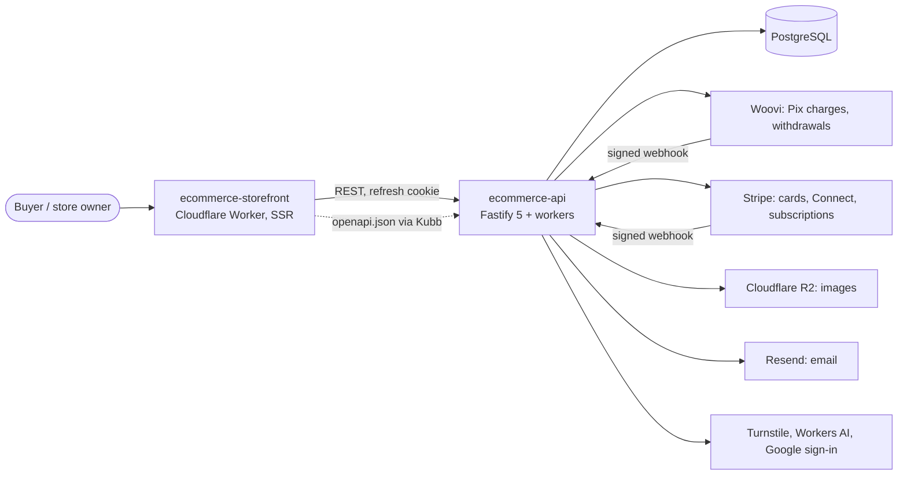
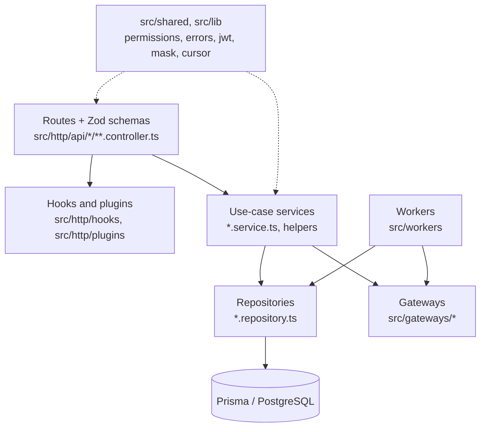
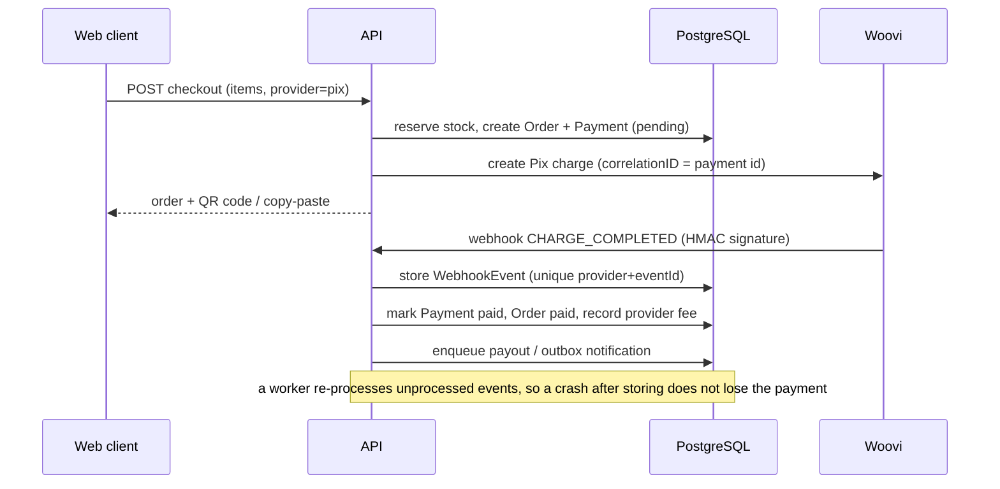
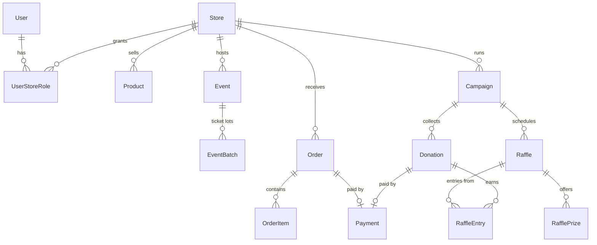

# ecommerce-api

REST API for a community storefront: stores, products, orders, donations, raffles, events and payouts, with Pix and card payments.

**Status:** Portfolio project. Source is published for review; no production traffic, users or revenue are claimed here. The default branch runs lint, type-check, migrations, tests and build in CI. Pre-existing docs: [engineering case study](docs/PORTFOLIO_CASE_STUDY.md), [architecture](docs/ARCHITECTURE.md), [ADRs](docs/DECISIONS.md), [integrations](docs/INTEGRATIONS.md), [deploy](docs/DEPLOY.md). Most of these are written in Portuguese.

## What it does

- Auth: email/password (argon2) and Google sign-in, short-lived JWT access tokens plus rotating refresh cookies (`src/http/api/auth`, `src/lib/jwt.ts`).
- Stores and products with presigned image uploads to Cloudflare R2 (`stores`, `products`, `uploads`).
- Checkout and orders paid by Pix (Woovi) or card (Stripe), with webhooks handled idempotently (`orders`, `billing`, `webhooks`).
- Donations, campaigns and raffles with a deterministic, auditable draw (`donations`, `campaigns`, `raffles`).
- Events with ticket lots, interest lists, reports and CSV export (`events`, `interests`, `reports`).
- Payouts and Stripe Connect onboarding for store owners (`payouts`, `connect`).
- Custom store domains and SaaS billing (`domains`, `billing`).
- OpenAPI 3 document exported from the route schemas ([`docs/openapi.json`](docs/openapi.json)).

## Architecture

System context: this repo is the only backend; the web client is a separate repo that consumes the exported OpenAPI document.



Layers inside this repo (arrows point to what a layer calls):



Main flow, a Pix purchase (checkout in `src/http/api/orders/checkout`, webhook in `src/http/api/webhooks/woovi-webhook.controller.ts`, settlement in `src/workers/webhook-processor.ts` and `payment-routing.ts`):



Data model summary (`prisma/schema.prisma`, 25 models; main entities only; `WebhookEvent` and `OutboxEvent` are standalone queue tables):



- One folder per use case inside each slice (for example `src/http/api/raffles/draw-raffle`), with a shared `*.repository.ts` and `*.schema.ts` per slice.
- External providers sit behind `src/gateways/*`; Woovi has a fake implementation (`woovi.fake.ts`) for local and e2e runs.
- Background jobs (`src/workers`) relay the outbox, process and retry webhooks, and expire reservations and donations.
- Order and donation share one `Payment` table (each row points at exactly one of them), so provider webhooks settle both through `payment-routing.ts`.
- The API is stateless apart from the database; deployment files live in `deploy/` and `docker-compose.prod.yml`.

## Key decisions

- Permissions are modelled as personas, and each route declares public access or a required set: [`src/shared/permissions.ts`](src/shared/permissions.ts), ADR-004 in [`docs/DECISIONS.md`](docs/DECISIONS.md).
- Own EdDSA JWT with rotating refresh tokens instead of a hosted identity provider (ADR-003; [`src/lib/jwt.ts`](src/lib/jwt.ts)).
- Webhooks are processed inline and re-processed by a worker, so a crash does not lose a payment (ADR-010; [`src/workers/webhook-processor.ts`](src/workers/webhook-processor.ts)).
- Notifications go through an outbox relay rather than inline sends ([`src/workers/outbox-relay.ts`](src/workers/outbox-relay.ts)).
- Raffle seed is generated at draw time and published with the result so anyone can recompute the winner (ADR-017; [`src/http/api/raffles/draw.ts`](src/http/api/raffles/draw.ts)).
- Sensitive values are masked and lists use cursor pagination ([`src/lib/mask.ts`](src/lib/mask.ts), [`src/lib/cursor.ts`](src/lib/cursor.ts)).
- The production database bootstrap and backup scripts are shell-tested in CI ([`scripts/test/`](scripts/test)).

## Tech stack

Node.js 22, TypeScript, Fastify 5, Zod 4 with fastify-type-provider-zod, Prisma 6, PostgreSQL, jose, argon2, Stripe, Resend, AWS S3 SDK (R2), Vitest, Biome, Docker.

## Getting started

Prerequisites: Node.js 22+, pnpm, Docker with Compose (for PostgreSQL).

```bash
cp .env.example .env     # fill placeholders; see table below
pnpm install
pnpm keys:generate       # creates a local JWT key pair
pnpm db:generate         # Prisma client
pnpm db:migrate
pnpm db:seed             # development users and sample data only
pnpm dev                 # http://localhost:3333 , docs at /docs
```

`.env.example` documents every variable. The main ones:

| Variable | Purpose |
| --- | --- |
| `DATABASE_URL` | PostgreSQL connection |
| `WEB_ORIGIN` | Allowed web origin (CORS, cookies) |
| `JWT_PRIVATE_KEY_B64`, `JWT_PUBLIC_KEY_B64` | Token signing keys (`pnpm keys:generate`) |
| `COOKIE_SECRET` | Cookie signing |
| `STRIPE_SECRET_KEY`, `STRIPE_WEBHOOK_SECRET` | Card checkout and webhooks |
| `WOOVI_BASE_URL`, `WOOVI_API_KEY`, `WOOVI_WEBHOOK_HMAC_SECRET` | Pix checkout and webhooks |
| `DEV_FAKE_PAYMENTS` | Fake Pix for local runs; refused in production |
| `R2_*` | Uploads bucket |
| `RESEND_API_KEY`, `EMAIL_FROM` | Transactional email |
| `TURNSTILE_SECRET_KEY` | Anti-bot challenge on anonymous writes |

Export the contract for the web client with `pnpm openapi:export`.

## Testing

77 test files (59 end-to-end against a real PostgreSQL, 18 unit/other) and 619 tests, all passing in the latest CI run on the default branch. CI also runs lint, type-check, migrations, build and shell checks of the deploy scripts.

```bash
pnpm lint && pnpm typecheck && pnpm test && pnpm build
```

Tests read `.env.test` (database on port 5434, test-only keys) and need a running PostgreSQL.

## Project structure

```text
src/http/api/   feature slices (routes, schemas, use cases, repositories)
src/gateways/   Woovi, Stripe, R2, email, Turnstile, AI, Google, DNS adapters
src/workers/    outbox relay, webhook processing, expiry jobs
src/shared/     permissions, errors
src/lib/        cursor, mask, jwt, slug, pix-key-owner, ...
prisma/         schema, migrations, seed
test/           e2e, unit, mocks
scripts/        keys, openapi export, deploy, backup and shell tests
deploy/         Postgres bootstrap and systemd units
docs/           architecture, ADRs, case studies, openapi.json
```

## Related repositories

- [ecommerce-storefront](https://github.com/mkwitko/ecommerce-storefront): the web client, generated from this API's OpenAPI document.

## License

All rights reserved. Source available for portfolio review.
