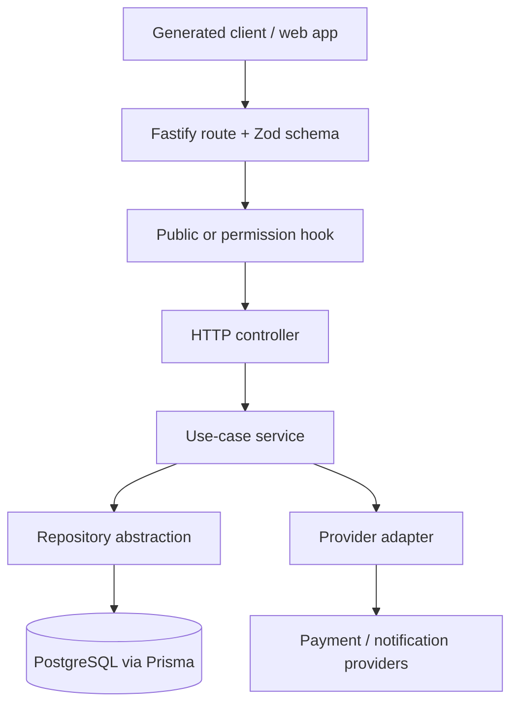

# Case study: Fastify API with explicit application boundaries

**Discipline:** Backend architecture, contract design, authorization, integration testing.

This API supports stores, products, orders, donations and other platform operations. The purpose of this case study is to show **inspectable engineering choices**, not to assert a verified scale, business result or security certification.

## Request flow

## Architecture decisions visible in source

| Boundary | Why it matters | What to inspect |
| --- | --- | --- |
| Controller ↔ service | Business rules do not need an HTTP context to run | [Login use case](../src/http/api/auth/login/) |
| Service ↔ repository | Database access is constrained behind a typed interface | [Auth repository](../src/http/api/auth/auth.repository.ts) |
| Service ↔ gateway | External providers can be substituted for tests | [Architecture](ARCHITECTURE.md) |
| Zod ↔ OpenAPI | The backend contract drives web client generation | [Exported specification](openapi.json) |
| Route ↔ permissions | Every route must explicitly declare its access policy | [Architecture and decisions](DECISIONS.md) |
| Test ↔ application factory | End-to-end tests use app injection and controlled infrastructure | [E2E test folder](../test/e2e/) |

### Engineering trade-offs

**Vertical slices** favor local feature ownership and focused tests. They also require consistent conventions to avoid diverging patterns between slices.

**Explicit access rules** help reviewers see authorization decisions. They do not replace threat modeling, permissions tests or production monitoring.

**Generated OpenAPI contracts** reduce duplication, but every schema change requires regeneration and client coordination.

**External gateway interfaces** help isolate provider SDKs and test business flows. They create another abstraction layer that needs careful maintenance.

## Security boundaries worth reviewing

- The Fastify app registers validation/serialization, CORS, Helmet, error handling and rate limiting. [Application factory](../src/app.ts).
- Auth supports tokens/cookies; production correctness depends on secret handling, secure cross-domain deployment and request authorization.
- Payment flows rely on provider configuration and webhook verification. Their presence in source is not a claim of certification.

## Code review itinerary

1. Read [architecture](ARCHITECTURE.md) and [decision records](DECISIONS.md).
2. Follow [login controller](../src/http/api/auth/login/login.controller.ts) → [service](../src/http/api/auth/login/login.service.ts) → repository.
3. Read a matching [auth test](../test/e2e/auth-register-login.test.ts).
4. Compare the exported [OpenAPI contract](openapi.json) to a generated client in [udv-shop](https://github.com/mkwitko/udv-shop).

## Quality evidence

The repository includes CI checks for lint, typecheck, tests, builds and some infrastructure scripts: [workflow source](../.github/workflows/ci.yml). Use the Actions runs, not this document, to determine the latest outcome.

**Not verified here:** production RPS, database scale, security posture, API p95, payment volumes or uptime.

## Evidence backlog

- [ ] Produce local API walkthrough and redacted requests with test-only data.
- [ ] Add method and environment for measured p50/p95 latency and throughput, if useful.
- [ ] Add a release/quality summary based on actual CI results.
- [ ] Confirm third-party provider and business-domain information is approved for public disclosure.
